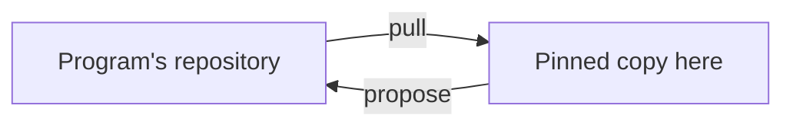

<!-- docs: covers=todo/11-apps/TODO-15-imported-programs.md sources=todo/imports.json,scripts/imports.py reviewed=2026-11-27 order=15 -->
# Imported Programs and Parts

## What is it?

Impossible OS gets many of its programs from their own repositories: games, tools, media programs, and the interface and libraries of [Impossible SDK](https://github.com/rizonesoft/ImpossibleSDK). They are written and proved on Windows first and imported here as source, each at a pinned commit. None has been imported yet.

## How does it work?

**Today.** The ledger [`todo/imports.json`](../../todo/imports.json) lists every source, the section that imports it and where its copy goes. `scripts/imports.py` checks it (lint Check 42), brings a source (`--pull`) and sends a change made here back as a pull request (`--propose`).

**Planned design.**

1. **Parts.** Impossible SDK, its parts and Impossible UI arrive first, because the programs are built with them.
2. **Programs.** Each program arrives when the OS can run it, with its tests.
3. **Changes.** A change made here lands here at once and goes to the program's repository; the pin moves when it is merged.
4. **Moved rows and builds.** A section that moves to another repository will carry the hash of its old text in the ledger (section 21), so a changed old text is detected. The SDK's `cxx` part gets its own import section (section 22), and one check compares each imported program's built executables with the hash its release recorded (section 23), so no program writes its own. None of the three is built yet.

## What are its interfaces?

| Interface                                | Status                                   |
| ---------------------------------------- | ---------------------------------------- |
| `scripts/imports.py --check`, `--list`   | Shipped                                  |
| `scripts/imports.py --pull`, `--propose` | Shipped; no source has been imported yet |

## How do I use it?

`python3 scripts/imports.py --list` prints every source. The rules are in [TODO metadata](../infrastructure/todo-metadata.md#work-that-lives-in-other-repositories).

## Who owns what?

- This roadmap owns the programs and parts that have no roadmap file of their own. Calculator, Notepad, Paint and the others that have one are imported by a section of their own file.
- [Fluent component library](../graphics/fluent-component-library.md) imports Impossible UI; the engines stay with [UI framework engines](../graphics/ui-framework-engines.md).

## What is not implemented yet?

- Every import of [the roadmap](../../todo/11-apps/TODO-15-imported-programs.md).

## How does it compare with Windows 11 and Linux?

Windows 11 ships inbox apps and updates them through the Store; Linux distributions package programs from many projects. Impossible OS imports the source of its own programs, so that one source runs on Windows and here.

## See also

- [Imported programs roadmap](../../todo/11-apps/TODO-15-imported-programs.md)
