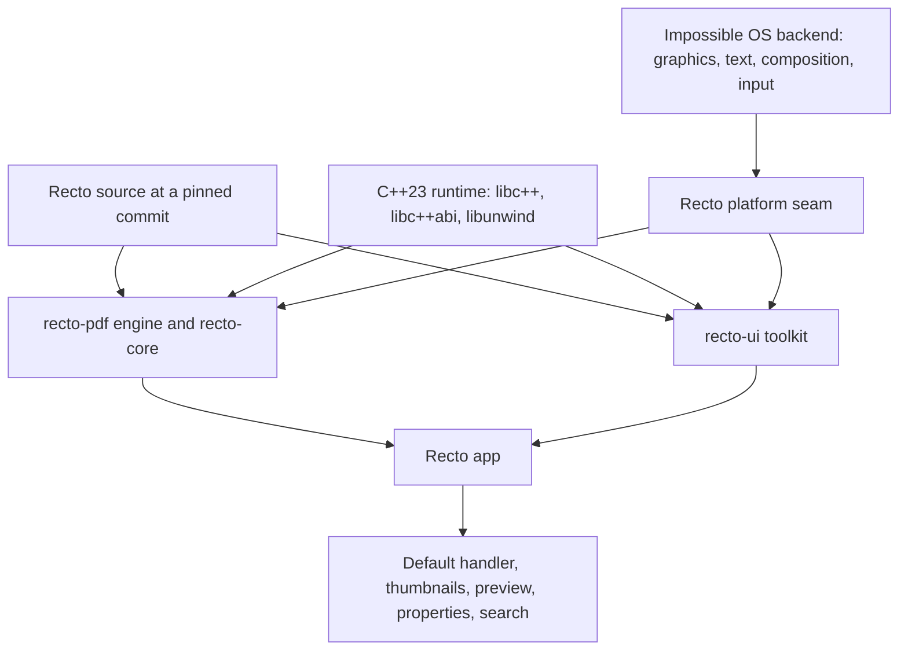

<!-- docs: covers=todo/11-apps/TODO-05-pdf-viewer.md sources=include/gfx.h,include/font_mgr.h,include/desktop/controls.h reviewed=2026-11-14 order=5 -->
# PDF App (Recto)

## What is it?

The PDF app of Impossible OS will be Recto, an open-source PDF viewer, OCR tool and document converter written in C++23 with its own PDF engine and its own interface toolkit. Impossible OS bundles it instead of writing a second, smaller PDF reader: Recto's source is imported at a pinned commit, built for Impossible OS, and registered as the handler for `.pdf` files. Nothing is built yet, here or in Recto itself.

## How does it work?

**Today.** No PDF code exists in Impossible OS, and user mode has a C library but no C++ runtime. Recto is at its first milestone (a repository and build scaffold) and targets Windows 11 directly. The drawing, text and controls it will be backed by are the existing [`gfx.h`](../../include/gfx.h), [`font_mgr.h`](../../include/font_mgr.h) and [`controls.h`](../../include/desktop/controls.h) and the engines planned on top of them.

**Planned design.** Recto is ported with a backend, not run as an unmodified Windows program. A platform seam inside Recto separates its engine and toolkit from the operating system; Windows keeps its Direct2D implementation, and Impossible OS supplies its own on the UI framework engines.

1. **Import.** Recto's source is copied in at a pinned commit and never edited locally; changes go into Recto and are re-imported.
2. **C++ runtime.** LLVM's libc++, libc++abi and libunwind are built for user mode.
3. **Platform seam and backend.** Recto's engine and toolkit call one interface; Impossible OS implements it with its own files, threads, drawing, text and input.
4. **App and integration.** Recto runs as the system PDF app and supplies thumbnails, the preview pane, file properties and search text for PDFs.
5. **Later features.** OCR, conversion and page organizing arrive as Recto ships them, by importing a newer commit that passes the conformance suite.

## What are its interfaces?

| Interface | Status |
| --- | --- |
| `gfx_*` drawing, `ttf_*` text, scroll bars | Shipped |
| C++23 user-mode runtime | Planned in this roadmap |
| `recto-platform` seam and the Impossible OS backend | Planned, in Recto and in this roadmap |
| `C:\Program Files\Recto\Recto.exe` and `recto-cli.exe` | Planned in this roadmap |
| `scripts/vendor-recto.sh`, `scripts/test-recto.sh` | Planned in this roadmap |

## How do I use it?

It cannot be launched yet. Nothing in this roadmap is runnable today.

To update the bundled Recto once it exists: change the pinned commit, re-run the import script, rebuild, and run the conformance suite. A hand edit under the imported tree is refused by the import script's check.

## What is not implemented yet?

Nothing in this roadmap has started. Its open sections, in build order:

- [Recto Source Import and Provenance](../../todo/11-apps/TODO-05-pdf-viewer.md#10-recto-source-import-and-provenance) and [C++23 User-Mode Runtime](../../todo/11-apps/TODO-05-pdf-viewer.md#11-c23-user-mode-runtime)
- [Recto Platform Seam](../../todo/11-apps/TODO-05-pdf-viewer.md#12-recto-platform-seam), [Recto PDF Engine on Impossible OS](../../todo/11-apps/TODO-05-pdf-viewer.md#13-recto-pdf-engine-on-impossible-os) and [Recto UI Backend on Impossible OS Engines](../../todo/11-apps/TODO-05-pdf-viewer.md#14-recto-ui-backend-on-impossible-os-engines)
- [Recto App on Impossible OS](../../todo/11-apps/TODO-05-pdf-viewer.md#15-recto-app-on-impossible-os), [OCR Provider](../../todo/11-apps/TODO-05-pdf-viewer.md#16-ocr-provider) and [Convert and Organize Features](../../todo/11-apps/TODO-05-pdf-viewer.md#17-convert-and-organize-features)
- [System Integration](../../todo/11-apps/TODO-05-pdf-viewer.md#18-system-integration), [Packaging and Updates](../../todo/11-apps/TODO-05-pdf-viewer.md#19-packaging-and-updates), [Recto Conformance on Impossible OS](../../todo/11-apps/TODO-05-pdf-viewer.md#20-recto-conformance-on-impossible-os) and [File Association](../../todo/11-apps/TODO-05-pdf-viewer.md#9-file-association)

The in-house parser, renderer and viewer window this roadmap used to plan are superseded by Recto and are kept only as pointers. Six sections wait on Recto's own milestones, because the code they build does not exist upstream yet.

## How does it compare with Windows 11 and Linux?

Windows 11 opens PDFs in Microsoft Edge's built-in reader, and Linux desktops ship Evince or Okular. Recto is planned as one native app with no browser engine, with OCR for scanned files, conversion and page organizing built in, which neither system's default viewer includes.

## See also

- [PDF app roadmap](../../todo/11-apps/TODO-05-pdf-viewer.md)
- [PDF Viewer Engine](../networking/pdf-viewer.md), the earlier in-house engine plan, now superseded
- [UI Framework Engines](../graphics/ui-framework-engines.md)
- [File Associations, Shortcuts and System Resources](../desktop/file-associations.md)
