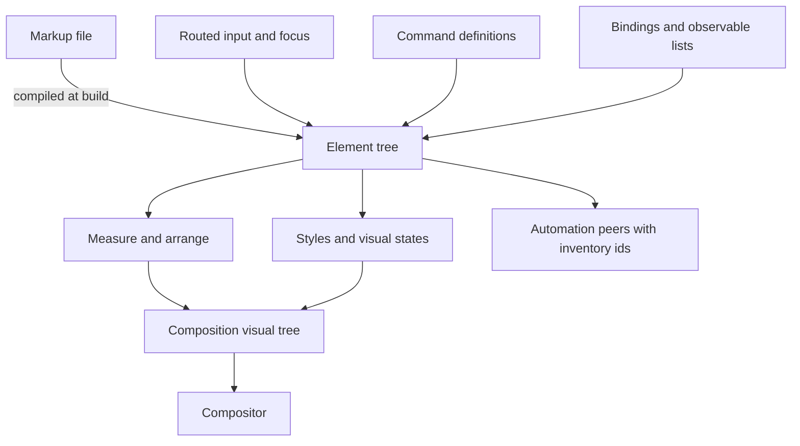

<!-- docs: covers=todo/08-graphics-ui/TODO-18-ui-framework-engines.md sources=src/desktop/controls.c,include/desktop/controls.h,src/desktop/wm.c,src/desktop/desktop.c reviewed=2026-11-14 order=19 -->
# UI Framework Engines

## What is it?

The UI framework engines are the base every shell surface and app window is assembled from: an element tree, a layout pass, styles and states, input routing, commands, data binding, a markup compiler, a composition tree, and the shell's own data engines. They exist so that a surface is declared once from shared parts instead of being painted by hand. Only the hand-painted starting point exists today.

## How does it work?

**Today.** [`controls.c`](../../src/desktop/controls.c) holds four controls (button, label, text box, scroll bar) in a fixed per-window table with absolute pixel rectangles, declared in [`controls.h`](../../include/desktop/controls.h). [`desktop.c`](../../src/desktop/desktop.c) and [`wm.c`](../../src/desktop/wm.c) paint the taskbar, Start menu and window chrome directly.

**Planned design.** A window's content becomes a tree of elements. Layout measures and arranges it, styles and visual states decide how it looks, and a retained tree of visuals lets the compositor move and fade things without repainting them. Pages are written in a markup file compiled to C tables at build time, so no parser runs in the OS.

Beside the framework sit the shell data engines: a settings platform where one definition feeds the page, the search entry and the deep link; a shell namespace and property system shared by File Explorer, the desktop and the file dialogs; extension points that run out of process; an app model; a resource engine; and supervised shell hosts that restart on their own.

## What are its interfaces?

Shipped today: the control functions in [`controls.h`](../../include/desktop/controls.h). Everything else is planned: `include/desktop/ui/element.h` and `visual.h`, the markup compiler `tools/uic`, the settings definition compiler `tools/sdefc`, the resource compiler `tools/resc`, and `include/shell/item.h`.

## How do I use it?

There is nothing new to run yet. The existing controls are created through the functions in `controls.h`.

## What is not implemented yet?

Every engine is planned and none is built. The [roadmap file](../../todo/08-graphics-ui/TODO-18-ui-framework-engines.md) owns them section by section: element tree and properties, layout and panels, scrolling and virtualization, styles and states, theme resources, routed input and focus, gestures, commands, binding, the markup compiler, composition, materials, the popup layer, navigation, the settings platform, the shell namespace, the property system, extension points, the app model, resources, the shell process model, the shell stores and automation peers.

## How does it compare with Windows 11 and Linux?

Windows 11 has these engines in WinUI and the shell, and Linux has them in GTK and Qt. Planned differences here: markup compiled with no runtime parser, one definition per command and per setting, extensions isolated from the shell, and shell surfaces that restart independently.

## See also

- [UI framework engines roadmap](../../todo/08-graphics-ui/TODO-18-ui-framework-engines.md)
- [Windows 11 Parity Inventory](win11-parity-inventory.md) and [Fluent Component Library](fluent-component-library.md)
- [Core Widgets](widget-library.md) and [Complex Controls and Dialogs](complex-controls-dialogs.md)
