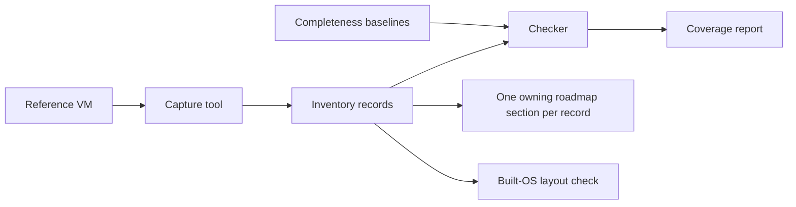

<!-- docs: covers=todo/08-graphics-ui/TODO-17-win11-parity-inventory.md sources=docs/design/tokens.json,docs/design/shell.md,docs/design/controls.md reviewed=2026-11-14 order=18 -->
# Windows 11 Parity Inventory

## What is it?

The parity inventory is a machine-readable list of every visible element of the Windows 11 interface: one record per taskbar button, menu entry, Settings control, dialog tab, shortcut and measured size. It exists so that "the same thing, in the same place" is a number that can be checked, not an impression. The format, the checker, the reference machine, the capture tool, the completeness baselines and the consistency ledger exist; no surface is captured yet and nothing is built from it.

## How does it work?

A capture tool walks the UI Automation tree of a clean Windows 11 reference virtual machine at one fixed display profile and writes records. Completeness baselines, read from the reference machine's own lists, prove that no page, applet or control was missed. Each record then gets a disposition (build it, build our own equivalent, replace it with one design of ours, or exclude it) and an owner: exactly one roadmap section that builds it.

Where Windows 11 disagrees with itself, a consistency ledger records the variants and the single rule Impossible OS ships instead. A record may be replaced only when the ledger names at least two captured records that disagree, so matching Windows 11 stays the default. The largest such rule: Settings is the one home for every setting, and the Control Panel name and its entry points open the matching Settings page. No physical laptop is used; a surface that needs hardware is shown by a stand-in in the virtual machine, captured on the Windows host, or recorded absent and designed as ours.

## What are its interfaces?

Shipped: the schema, the checker, the capture tool and the ledger. Planned: the records, the report and the layout check.

- `docs/design/inventory/schema.json`: the record format.
- `docs/design/inventory/<surface>/*.json`: the records, one JSON object per line.
- `docs/design/inventory/consistency.json`: the consistency ledger, seeded with nine entries; the [inventory format](../design/inventory/index.md#how-are-decisions-recorded) says how a record cites it.
- `scripts/inventory/check-inventory.py`, `capture-ui.py`, `inventory-report.py`, `layout-check.py`: the checker, the capture tool, the coverage and ownership report, and the comparison of the built OS with the reference.

The design inputs it corrects exist today: [`tokens.json`](../design/tokens.json), the [shell specification](../design/shell.md) and the [controls specification](../design/controls.md).

## How do I use it?

`python3 scripts/inventory/check-inventory.py` validates the inventory, its baselines and the ledger. `python3 scripts/inventory/inventory-report.py --owners --check`, which lists any record without an owner, is not written yet.

## What is not implemented yet?

No surface is captured and nothing is built from the inventory yet. The schema and checker, the reference machine, the capture tool, the baselines, and the dispositions and ledger are done. The [roadmap file](../../todo/08-graphics-ui/TODO-17-win11-parity-inventory.md) owns the rest: the coverage report, the capture matrix and its fixtures, the inventory of each surface (desktop, taskbar, Start, flyouts, window chrome, secure screens, Settings, File Explorer, dialogs, Control Panel, system tools, inbox apps), the shortcut, gesture, metric and motion catalogues, the authoring step that assigns every record to a roadmap section, the built-OS layout check, and the pixel comparison against reference screenshots that holds the build to a pixel-perfect standard (only replaced copyrighted regions may differ). The reference machine is built from the Windows 11 image at `R:\11\win11.iso` and stored in `R:\11\ios-win11-ref\`.

## How does it compare with Windows 11 and Linux?

Windows exposes its interface through UI Automation and Linux through AT-SPI, but neither publishes its interface as data or checks a build against a reference. The inventory, the one-owner rule and the layout check are planned here and have no counterpart in either.

## See also

- [Windows 11 parity inventory roadmap](../../todo/08-graphics-ui/TODO-17-win11-parity-inventory.md)
- [UI Framework Engines](ui-framework-engines.md) and [Fluent Component Library](fluent-component-library.md)
- [Design System](../design/index.md)
