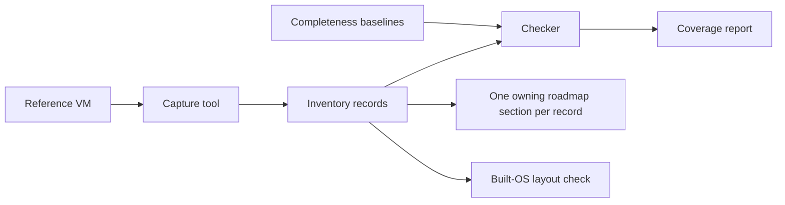

<!-- docs: covers=todo/08-graphics-ui/TODO-17-win11-parity-inventory.md sources=docs/design/tokens.json,docs/design/shell.md,docs/design/controls.md reviewed=2026-11-14 order=18 -->
# Windows 11 Parity Inventory

## What is it?

The parity inventory is a machine-readable list of every visible element of the Windows 11 interface: one record per taskbar button, menu entry, Settings control, dialog tab, shortcut and measured size. It exists so that "the same thing, in the same place" is a number that can be checked, not an impression. Nothing is implemented yet.

## How does it work?

A capture tool walks the UI Automation tree of a clean Windows 11 reference virtual machine at one fixed display profile and writes records. Completeness baselines, read from the reference machine's own lists, prove that no page, applet or control was missed. Each record then gets a disposition (build it, build our own equivalent, or exclude it) and an owner: exactly one roadmap section that builds it.

Where Windows 11 disagrees with itself, a consistency ledger records the variants and the single rule Impossible OS ships instead.

## What are its interfaces?

All planned, none shipped:

- `docs/design/inventory/schema.json`: the record format.
- `docs/design/inventory/<surface>/*.json`: the records, one JSON object per line.
- `docs/design/inventory/consistency.json`: the consistency ledger.
- `scripts/inventory/check-inventory.py`, `capture-ui.py`, `inventory-report.py`, `layout-check.py`: the checker, the capture tool, the coverage and ownership report, and the comparison of the built OS with the reference.

The design inputs it corrects exist today: [`tokens.json`](../design/tokens.json), the [shell specification](../design/shell.md) and the [controls specification](../design/controls.md).

## How do I use it?

There is nothing to run yet. When the first sections land, `python3 scripts/inventory/check-inventory.py` validates the inventory and `python3 scripts/inventory/inventory-report.py --owners --check` lists any record without an owner.

## What is not implemented yet?

Nothing is implemented yet. The [roadmap file](../../todo/08-graphics-ui/TODO-17-win11-parity-inventory.md) owns all of it: the schema and checker, the reference machine, the capture tool, the baselines, the inventory of each surface (desktop, taskbar, Start, flyouts, window chrome, secure screens, Settings, File Explorer, dialogs, Control Panel, system tools, inbox apps), the shortcut, gesture, metric and motion catalogues, the authoring step that assigns every record to a roadmap section, and the built-OS layout check. The reference machine needs a Windows 11 installation image supplied by the operator.

## How does it compare with Windows 11 and Linux?

Windows exposes its interface through UI Automation and Linux through AT-SPI, but neither publishes its interface as data or checks a build against a reference. The inventory, the one-owner rule and the layout check are planned here and have no counterpart in either.

## See also

- [Windows 11 parity inventory roadmap](../../todo/08-graphics-ui/TODO-17-win11-parity-inventory.md)
- [UI Framework Engines](ui-framework-engines.md) and [Fluent Component Library](fluent-component-library.md)
- [Design System](../design/index.md)
