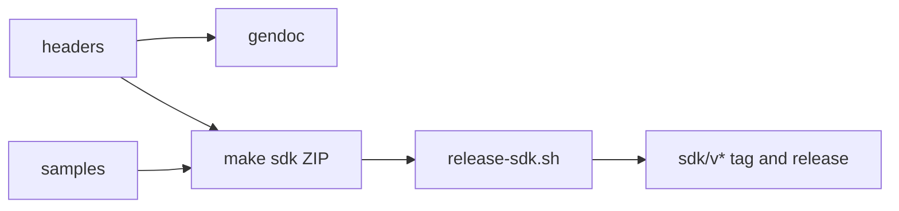

<!-- docs: covers=todo/12-user-platform-sdk/TODO-06-sdk-distribution.md sources=include/kernel/version.h reviewed=2026-11-23 order=6 -->
# SDK Distribution and Developer Experience

## What is it?

This roadmap plans how developers get and use the Impossible OS SDK: a `make sdk` ZIP with a SHA-256 checksum, API documentation generated from the headers, seven code samples, a sampling profiler, a small unit test framework (`itest.h`), debugger improvements, an `ixui-new` project template and a release pipeline that tags and publishes SDK versions. None of the nine sections has shipped. The SDK itself is a separate project, [Impossible SDK](https://github.com/rizonesoft/ImpossibleSDK); paths here that start with `ImpossibleSDK/` are in that repository.

## How does it work?

**Today.** This repository ships no application SDK. Its old `sdk/` folder (one header of file API declarations, one example, a hand-written reference and an empty library folder) was removed on 2026-11-23 in favour of Impossible SDK, which is developed separately and has no public release yet. Impossible SDK programs run on Windows today and not yet on Impossible OS. The host tools that shared the folder moved to [`tools/`](../host-tools/host-tools-build.md).

None of the roadmap's scripts or tools exist: no `make sdk`, `make docs` or `make sdk-upload` target, no `scripts/sdk-package.sh`, `release-sdk.sh` or `bump-version.sh`, and no `tools/gendoc.c`.

**Planned design.**

1. **Packaging.** `make sdk` collects headers, import libraries, documents and samples into one versioned ZIP with a checksum. The version comes from `VERSION_MAJOR`, `VERSION_MINOR` and `VERSION_PATCH` in [`version.h`](../../include/kernel/version.h).
2. **Documentation.** `gendoc` reads header comments and writes an API reference, which the documentation site will publish under `docs/sdk/api/`.
3. **Samples and templates.** Seven samples from console to GUI, and `ixui-new` to start a GUI project from them.
4. **Profiler, tests and debugger.** A 1000 Hz timer-driven sampling profiler, `itest.h` tests registered automatically through a linker section, and unwind-table stack traces in the debugger with a frame-pointer fallback.
5. **Release pipeline.** `release-sdk.sh` tags `sdk/v*`, builds and uploads the ZIP; the OS keeps an `sdk-info` record of the installed version.

## What are its interfaces?

| Interface | Status |
| --- | --- |
| `make sdk`, `scripts/sdk-package.sh` | Planned in section 1 |
| `gendoc` | Planned in section 2 |
| `ImpossibleSDK/samples/` | Planned in section 3 |
| Profiler, `itest.h` | Planned in sections 4 and 5 |
| `ixui-new` | Planned in section 7 |
| `release-sdk.sh`, `sdk-info` | Planned in section 8 |

## How do I use it?

There is nothing to install yet. To build a program for the OS today, follow the host build described in [Compiler and SDK](../services/compiler-sdk.md): add it to the kernel `Makefile`'s userland target and run `bash scripts/build.sh`.

## Who owns what?

- The [Compiler and SDK](../services/compiler-sdk.md) roadmap (`10-platform-services/TODO-09`) owns the headers, import libraries, the on-OS compiler, the SDK installer (its section 9) and the SDK documents (section 10). This file's sections 1 and 2 extend those; the two roadmaps both describe an SDK installer and ZIP.
- The [long-term features](../services/long-term-features.md) roadmap (`10-platform-services/TODO-12`) owns the user-mode debugger (its section 2) that section 6 extends.
- Impossible SDK (a separate repository) owns the headers, libraries, documents and samples under `ImpossibleSDK/`.
- The host tools build roadmap (`14-host-tools/TODO-01`) owns `tools/build-host.sh`, documented in [Host Tools Build](../host-tools/host-tools-build.md).
- The documentation site roadmap's section 30 publishes the generated reference per SDK tag.

## What is not implemented yet?

- [SDK Packaging](../../todo/12-user-platform-sdk/TODO-06-sdk-distribution.md#1-sdk-packaging-make-sdk)
- [SDK Documentation](../../todo/12-user-platform-sdk/TODO-06-sdk-distribution.md#2-sdk-documentation-gendocc)
- [Code Samples](../../todo/12-user-platform-sdk/TODO-06-sdk-distribution.md#3-code-samples): the roadmap puts them in `ImpossibleSDK/samples/`
- [Sampling Profiler](../../todo/12-user-platform-sdk/TODO-06-sdk-distribution.md#4-sampling-profiler)
- [Unit Test Framework](../../todo/12-user-platform-sdk/TODO-06-sdk-distribution.md#5-unit-test-framework-itesth)
- [Debugger Enhancements](../../todo/12-user-platform-sdk/TODO-06-sdk-distribution.md#6-debugger-enhancements)
- [IxUI Starter Templates](../../todo/12-user-platform-sdk/TODO-06-sdk-distribution.md#7-ixui-starter-templates-ixui-new)
- [SDK Release Pipeline](../../todo/12-user-platform-sdk/TODO-06-sdk-distribution.md#8-sdk-release-pipeline)
- [User-Space Runtime Licensing](../../todo/12-user-platform-sdk/TODO-06-sdk-distribution.md#9-user-space-runtime-licensing)

## How does it compare with Windows 11 and Linux?

The Windows SDK is a multi-gigabyte installer or a WinGet package, with reference documentation on Microsoft Learn, profiling through ETW and VTune and debugging in WinDbg. Linux distributions install toolchains with `apt install build-essential` or its equivalent, document APIs with man pages and Doxygen, and profile with `perf`. The Impossible OS plan is a single small ZIP with its checksum, a reference generated from the same headers it ships, and a built-in profiler and test framework.

## See also

- [SDK Distribution and Developer Experience roadmap](../../todo/12-user-platform-sdk/TODO-06-sdk-distribution.md)
- [Compiler and SDK](../services/compiler-sdk.md)
- [Win32 API Surface](../services/win32-api-surface.md)
- [Development Tooling](../infrastructure/development-tooling.md)
